# Don't Spill the Tea: A Polite Guide to Error Handling in Rust

Cordial is a tool for keeping a codebase well-mannered. It is a flexible static
analysis framework: you describe a standard as a bundle of lints (we call a
bundle an *etiquette*), and cordial checks your code against it, explains each
finding, and writes a report you can act on. Among others, it ships with
etiquettes for error handling, observability, and API shape, and you can write
your own for whatever your project considers polite.

This article is about the error-handling etiquettes, the most intricate of the
set, and about what it takes to steer a coding agent through them. The core idea
fits in one image, an arm holding a cup of tea, and the article works down from
that image to the machinery underneath it.

The error pattern at the center of it, the one this article calls *steady*, is
a design used consistently across several projects. It takes inspiration from
Sabrina Jewson's article
[Modular Errors in Rust](https://sabrinajewson.org/blog/errors), and the
etiquettes are how cordial checks for it.

## An agent in a loop

Much code is now written by an agent working in a loop: it edits, runs a check,
reads what the check says, and edits again until the check passes. Cordial is
built to be that check.

For the current command-by-command loop, run `cordial instructions` and see
[Agent worklist](running-cordial.md#agent-worklist). The diagram below shows
the report and rule explanation behind that workflow.

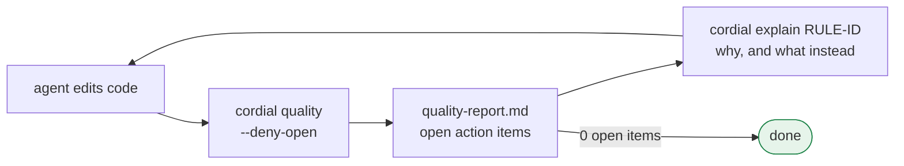

Two commands carry the loop. `cordial quality -p . --deny-open` runs the lints
and writes a report of open action items, and it fails while any remain. Where a
finding has a concrete rewrite, its checklist row in the report carries that
too. `cordial explain` prints a page for the etiquette behind a finding, and it
accepts either the etiquette's id or any rule id that etiquette emits.

Suppose an agent wrote `.unwrap()` in library code and the report shows a
`PANIC-SOURCE-UNWRAP` finding. It asks:

```sh
cordial explain PANIC-SOURCE-UNWRAP
```

and reads this (abridged):

```markdown
# Panic sources (`panics`)

Where does this crate abort?

## Why

Abort sites are the first error-handling layer. Library code should return the
crate's internal error type (preserving source()); binaries and tests should
surface through miette.

## Logic

Inventories panic!, unwrap, expect, unreachable!, and compile_error!. … Test
unwrap/expect (including #[cfg(test)] modules under src/) stay on the checklist
rather than becoming CSV-only inventory.

## Opt out

`[panics] enabled = false` in cordial.toml.

## Rules

- `PANIC-SOURCE-PANIC` — `panic!` in source
- `PANIC-SOURCE-UNREACHABLE` — `unreachable!` in source
- `PANIC-SOURCE-EXPECT` — `.expect(...)` in source
- `PANIC-SOURCE-UNWRAP` — `.unwrap()` in source
- `PANIC-SOURCE-COMPILE-ERROR` — `compile_error!` in source
```

The page is organized the same way for every etiquette: a one-line summary, why
the check exists, the logic of what it flags and ignores, how to opt out, and
the rule ids with a note each. A rule id resolves to the page of the etiquette
that owns it, so the agent gets the whole policy and not only the one rule.

An agent doesn't know your house style. It knows what the report and these pages
tell it, so those words are the entire steering signal. That puts a lot of
weight on what the lints say, and on what they leave unsaid.

## A lint alone isn't enough

Cordial's unit is the single lint: one rule id for each bad move, each with a
place on an explain page and its own handle for exceptions. That granularity is
what makes the feedback specific enough to act on.

Specific feedback has a catch, which is that an agent satisfies the lint it was
shown. Consider what it reaches for when the only pressure is the compiler. A
`.unwrap()`. A `.map_err(|e| e.to_string())`. A `Box<dyn Error>` on the return
type. Each makes the red squiggle go away, and each throws away something a
caller or a maintainer would have wanted: the cause of the failure, the place it
happened, or the type that says what can go wrong.

These are local optima. If the only feedback is "does it compile?", the
cheapest way to compile is to discard information, and the same thing happens
one level up. Ban `unwrap` and you get `unwrap_or_default`. Ban stringifying and
you get `Box<dyn Error>`. Overcorrect by demanding wrappers everywhere and you
get a wrapper around an error that carried nothing.

So the interesting question is not whether each bad move has a lint but how the
lints are arranged. If every move that escapes one lint runs into another lint
pulling the other way, there is no direction left to drift in. The error-handling
etiquettes are built that way, as lints that create antagonistic pressure on each
other.

## The cup

Think of an error as a cup of tea being carried from one place to another. The
tea is the detail: what went wrong, where, and what kind of failure it was.

The cup changes hands wherever an error from somewhere else becomes an error in
your crate. In Rust that is a `?`, a `map_err`, an `ok_or`, or a `return Err(..)`.

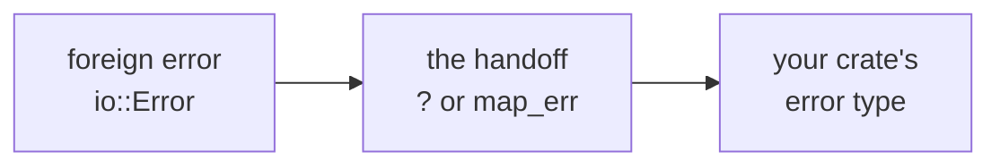

What matters at each handoff is whether the detail arrives intact and whether
your callers end up holding something that belongs to you.

## Two ways to spill

An error can be handled at the wrong level of abstraction in two opposite
directions.

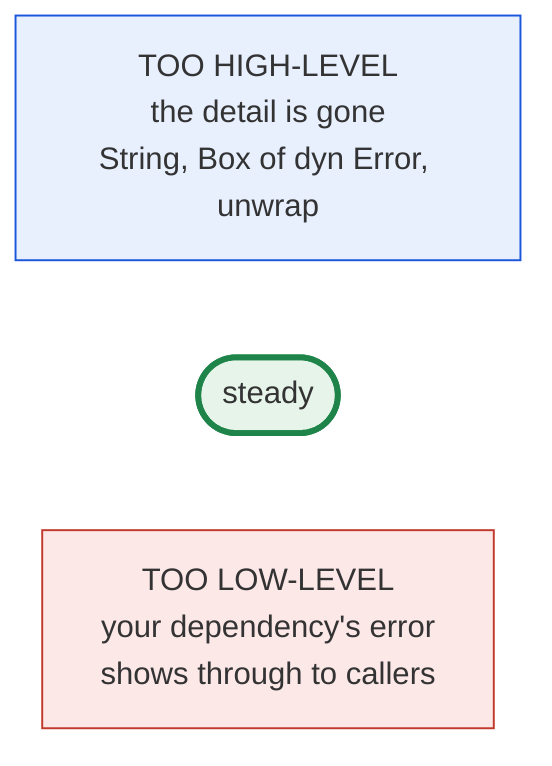

**Too high-level** means the error has been abstracted until nothing useful is
left. `.to_string()`, `Result<_, String>`, `Box<dyn Error>`, and `unwrap` all
end at "something failed", with no cause, no location, and no type a caller can
match on. The cup has been raised out of sight and arrives nearly empty.

**Too low-level** means the error is exposed at your dependency's level of
abstraction. A public function returns `io::Error` as is, with no error type of
your own between your callers and your internals. Every caller is now coupled to
a type you don't control, and a major-version bump upstream becomes a breaking
change for you.

**Steady** sits between them: an error type of your own that carries the foreign
error as `source()` and records where it was picked up. Callers see your
abstraction, and a debugger can still walk down to the original failure.

That walk follows the *error chain*. Every error's `source()` names the error
that caused it, so a failure reads as a list from the outermost error down to
the original one, which is how `anyhow` and `miette` print their "Caused by:"
lists. Each handoff either adds a link or cuts the chain. A wrapper with a
`source` field adds one. A `.to_string()` cuts the chain, because a string has
no `source()` to follow. Cordial calls a cut a *chain break*.

## One muscle isn't enough

Your upper arm has two muscles that pull in opposite directions. The biceps lifts
the forearm and the triceps lowers it, and a pair that works against each other
like this is called antagonistic. Neither holds a cup steady alone: with only the
biceps the cup keeps rising, and with only the triceps it sinks.

A rule set can be built the same way. A lint aimed at one failure leaves the
other side unguarded, and an agent that gets steered away from one will drift
toward the other. With a lint on each side pulling against the other, drift in
either direction meets a correction, and the stable position is the one between
them.

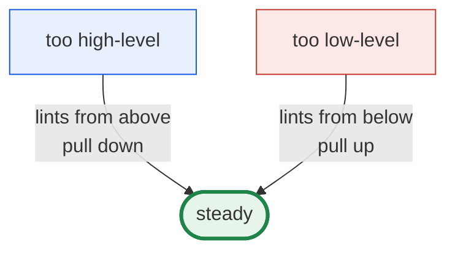

## One function, five drafts

Here is that dynamic for a single function that reads and parses a config file,
going around the loop from the start of this article. Every draft is a pattern
that turns up consistently in real code, and they are the same samples that
motivated the lints in the first place. The quoted advice is the wording
cordial's checklist rows and `cordial explain` pages use, which is what the
agent reads between drafts.

### Draft 1: the one nobody was watching

```rust
pub fn load_config(path: &Path) -> Result<Config, String> {
    let text = std::fs::read_to_string(path).map_err(|e| e.to_string())?;
    toml::from_str(&text).map_err(|e| e.to_string())
}
```

The first run of the check reports three kinds of open item, all pulling down.
`ANTIPATTERN-STRING-ERROR-001` flags the signature as a "`Result<_, String>`
carrier", `ERROR-CHAIN-COMPLIANCE-STRINGIFY-001` flags each `map_err` as one that
"stringifies a foreign error", and the chain-break row in the attenuation
checklist carries the fix:

> **`ERROR-HANDLING-CHAIN-BREAK`**: Introduce a crate error newtype (or enum
> variant) that holds `std::io::Error` as `source` and implements
> `std::error::Error` + `From<std::io::Error>`. Then
> `std::fs::read_to_string(…)?`. Do not use
> `Result<_, String>` or stringify with `.to_string()` / `format!("...{err}")`.

The advice says to introduce a type. That means designing one, and a shortcut is
sitting right there.

### Draft 2: the shortcut

```rust
pub fn load_config(path: &Path) -> Result<Config, Box<dyn Error>> {
    let text = std::fs::read_to_string(path)?;
    Ok(toml::from_str(&text)?)
}
```

`Box<dyn Error>` lets `?` convert anything, so the string findings and the chain
breaks are gone. A different lint now answers: `ANTIPATTERN-BOX-DYN-ERROR-001`,
a "`Box<dyn Error>` carrier". Asking `cordial explain` about it says why these
antipatterns matter: "they erase types". The cause survives, but a caller can no
longer say what kind of failure it was.

The agent has now been told twice to introduce a type, and the first piece of
advice even said what the type could be.

### Draft 3: the advice, taken literally

```rust
pub enum ConfigError {
    Io(std::io::Error),
    Toml(toml::de::Error),
}
```

The first advice said an "enum variant" that holds the foreign error would do,
and this is that, so the lints that complained before are quiet. A different
etiquette now takes over, and this time it pulls up. `internal_error_chain`
reports two findings, "Parent does not box Kind" and "Kind variant is not a
native source". `cordial explain internal_error_chain` says what it is checking:

> Foreign-error etiquettes ask what leaks in. This one asks whether our error
> types are a place those leaks can land. … A parent boxes an umbrella `*Kind`
> enum; every Kind variant holds a native source.

The earlier advice was true but incomplete. It described how to keep the foreign
error, and this advice describes where it has to live. Callers can still match on
`std::io::Error` and `toml::de::Error` straight through this enum, which is the
too-low-level failure from earlier, and nothing in draft 1's advice could see it.

### Draft 4: the right shape, built wrong

```rust
pub struct ConfigError { kind: Box<ConfigErrorKind> }

pub enum ConfigErrorKind {
    Io(IoSource),
    Toml(TomlSource),
}

pub struct IoSource { source: std::io::Error, file: String, line: u32 }

impl IoSource {
    pub fn new(source: std::io::Error, file: &str, line: u32) -> Self {
        Self { source, file: file.to_string(), line }
    }
}

// call site
let text = std::fs::read_to_string(path)
    .map_err(|e| ConfigError::from(IoSource::new(e, file!(), line!())))?;
```

The structure is right and the architecture findings are gone. Now the shape
check catches a detail. `ERROR-CHAIN-COMPLIANCE-SOURCE-TRACK-CALLER-001` says
that `IoSource::new` "must be `#[track_caller]`", "must call
`Location::caller()` in its body", and "must not take file/line/location".
Passing `file!()` and `line!()` works, but it makes every call site spell the
location out by hand, no `From` impl can supply it, and a plain `?` is off the
table. The same explanation says native sources keep the foreign error in
`source` "with owned file/line from `Location::caller()` and `#[track_caller]`".

### Draft 5: steady

```rust
impl IoSource {
    #[track_caller]
    pub fn new(source: std::io::Error) -> Self {
        let loc = Location::caller();
        Self { source, file: loc.file().to_string(), line: loc.line() }
    }
}

impl From<std::io::Error> for ConfigError {
    #[track_caller]
    fn from(source: std::io::Error) -> Self {
        Self { kind: Box::new(ConfigErrorKind::Io(IoSource::new(source))) }
    }
}

// the same for toml::de::Error and TomlSource

pub fn load_config(path: &Path) -> Result<Config, ConfigError> {
    let text = std::fs::read_to_string(path)?;
    Ok(toml::from_str(&text)?)
}
```

A `?` converts with the `From` impl of the type the function returns, so the
`From` impls live on `ConfigError` and build the native source inside. Both `?`
sites go through them, so each is `ERROR-HANDLING-CHAIN-PRESERVED`. The body is
shorter than draft 1, every failure carries its cause and the line where it
happened, and nothing was spilled.

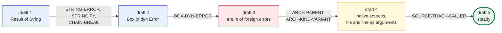

Each lint knew only which way it was pulling and what its own side looked like.
The route to the right answer is whatever remains after every wrong exit has a
lint standing on it.

## Finding every handoff

Those findings have to come from somewhere. Before anything can be corrected,
the handoffs have to be found. A single scan parses each source file once and
walks its syntax tree once, collecting every `?`, `map_err`, `ok_or`,
`return Err`, `if let Err`, and `match` on an `Err`. That inventory is what
`error_sites` reports.

Each site is then linked to the origin of its error by an `ErrorFlow` edge in the
IR graph, so a question like "which handoffs touch `std::io`?" becomes a graph
query.

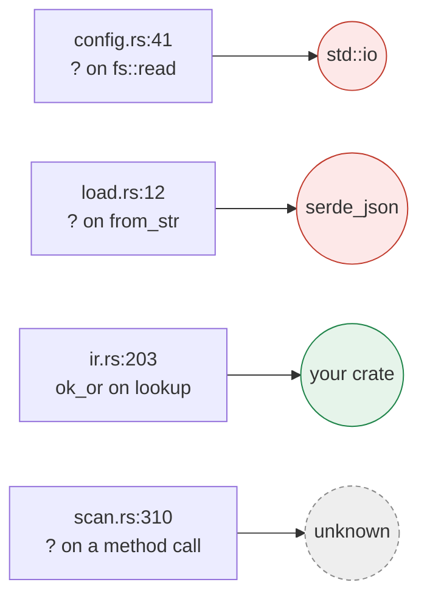

The scan sees syntax, not types, so the origin is inferred. A crate error
constructor, a same-crate path, or an `ok_or` counts as your own error. A `std::`
or third-party path counts as foreign, and the crate name becomes the origin
detail. Anything the scan can't resolve, such as a method call on a receiver
whose type isn't visible, is marked unknown and left for a person instead of
being guessed at.

`error_chain` then asks of each conversion whether it kept the cause. The
preferred wrap is a bare `?` when a `From` impl exists, or a `map_err`
closure that calls a constructor which keeps the foreign error. Passing a
caller-tracking constructor as a function item to `map_err` loses the caller's
location. Turning
the error into text, whether with `.to_string()` or with `format!("{err}")`,
is a chain break. Probe results and error sites are matched by file and line, so
`map_err(..)?` on one line counts as one handoff.

`error_chain` reports the conversions that drop the cause, and it also records
the ones that keep it, because those are the examples the later stages point to.

## What steady looks like

Draft 5 above works because the middle is defined precisely. Without a
fixed target the agent improvises its way to a cheap exit, so
`internal_error_chain` defines the target as a fixed shape for your crate's own
error types. The rule ids below state that shape as checks.

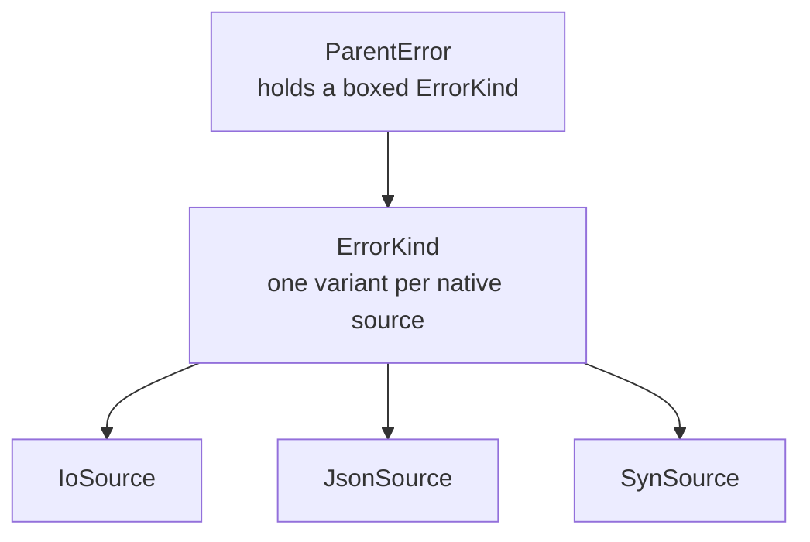

A parent error boxes a `Kind` enum, which leaves room on the parent for extra
context. Every variant of the Kind is a *native source*: a small struct of yours
that wraps exactly one foreign error. A native source holds that error as
`source`, along with the `file` and `line` where it was picked up. A native source
may itself box a nested Kind and repeat the pattern.

```rust
pub struct IoSource {
    source: std::io::Error,
    file: String,
    line: u32,
}

impl IoSource {
    #[track_caller]
    pub fn new(source: std::io::Error) -> Self {
        let loc = Location::caller();
        Self { source, file: loc.file().to_string(), line: loc.line() }
    }
}

impl From<std::io::Error> for ConfigError {
    #[track_caller]
    fn from(source: std::io::Error) -> Self {
        Self { kind: Box::new(ConfigErrorKind::Io(IoSource::new(source))) }
    }
}
```

The rules check that this shape holds. All of their ids start with
`ERROR-CHAIN-COMPLIANCE-`:

| Suffix | Checks |
| --- | --- |
| `ARCH-PARENT-001` | one parent error that boxes a Kind |
| `ARCH-KIND-BOX-001` | the `kind` field is a `Box` |
| `ARCH-KIND-VARIANT-001` | Kind variants are native sources |
| `ARCH-ORPHAN-SOURCE-001` | no native source is left out of the Kind |
| `SOURCE-SHAPE-001` | native sources have `source` plus owned `file` and `line` |

The example above uses the default error field strategy, `owned`. To check a
borrowed error representation instead, set:

```toml
[internal_error_chain]
field_strategy = "borrowed"
```

In this mode the parent holds `kind: &'a ErrorKind<'a>`. Kind variants and
native source fields must borrow every non-`Copy` value, including the foreign
`source`; `line: u32` can remain owned. The call-site file is
`file: &'static str`, taken from `Location::caller().file()`. The general
`[antipatterns.static_refs]` strategy still applies to other types. Borrowing
a foreign source with a nonstatic lifetime also affects whether an
`std::error::Error::source()` implementation can return it, because that trait
method exposes only `'static` source trait objects.

The borrowed mode adds `FIELD-STRATEGY-001` for owned non-`Copy` fields and
changes `ARCH-KIND-BOX-001` to require a borrowed Kind.

### Recording the right line

`Location::caller()` returns the call site of the nearest `#[track_caller]`
function. A `?` calls `From::from`, so with the attribute on `From::from` and on
`new`, the recorded location is the `?` itself. Every function between the `?`
and `Location::caller()` has to carry the attribute. Miss one and the recorded
location is a line inside your own `From` impl.

`Result::map_err` does not carry `#[track_caller]` through a function item.
Thus `.map_err(ConfigError::from)?` can record a standard-library location even
when `From::from` and `new` are annotated. Prefer the bare `?` shown above. If
an explicit conversion is needed, `.map_err(|err| ConfigError::from(err))?`
calls the converter on the closure's source line.

Keep `#[instrument(ret)]` off caller-tracking constructors too. Its generated
return-value wrapper puts the constructor body in a closure, so
`Location::caller()` records the wrapper's line instead of the original call.
`#[instrument]` without `ret` still records the span.

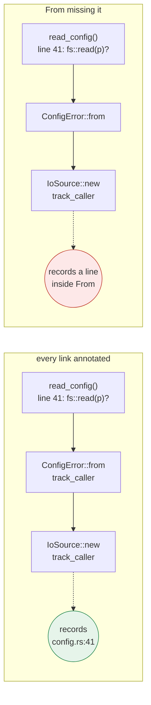

`ERROR-CHAIN-COMPLIANCE-SOURCE-TRACK-CALLER-001` enforces the constructor chain;
`ERROR-CHAIN-COMPLIANCE-MAP-ERR-TRACK-CALLER-001` catches tracked converters
passed as function items. `new` must call
`Location::caller()` itself, and it must not take file and line as arguments,
since a location passed by hand has to be spelled out at every call site, where
no `From` impl can supply it. Every parent `From` or constructor has to be
annotated as well.

### Libraries, binaries, and tests

The steady shape depends on who is reading. A library's errors go to callers,
so its target is the typed crate error above. A binary or a test is the end of
the line, so it only has to report well, and its target is a `miette` report.

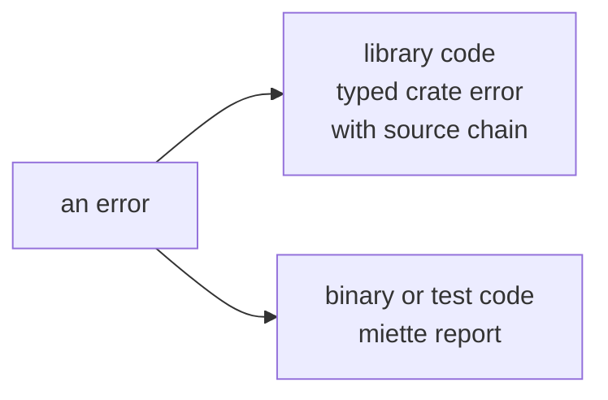

That is why an `.unwrap()` in a test is still a finding: the right test returns
`miette::Result` and uses `into_diagnostic`.

## The lints that pull down

There are many ways to lose detail, so this side has the most lints. Each pulls
the design back toward the cause.

| The move | Caught by |
| --- | --- |
| `.unwrap()`, `.expect(..)`, `panic!`, `compile_error!` | `panics`: `PANIC-SOURCE-UNWRAP`, `-EXPECT`, `-PANIC`, `-COMPILE-ERROR` |
| `unreachable!()` in a dead match arm | `PANIC-SOURCE-UNREACHABLE` |
| `.to_string()` on a foreign error, or interpolating it with `format!`, inside a `map_err` or `Err(..)` | `ERROR-CHAIN-COMPLIANCE-STRINGIFY-001` |
| Handing a foreign error to a message-only constructor such as `invariant(..)`, which can't keep it as `source` | `ERROR-CHAIN-COMPLIANCE-DISCARD-TYPED-001` |
| `Result<_, String>` | `ANTIPATTERN-STRING-ERROR-001` |
| `Box<dyn Error>` | `ANTIPATTERN-BOX-DYN-ERROR-001` |
| A wrapper with no `source` field | `ERROR-CHAIN-WRAPPER-SOURCE-001` |
| A `From` that drops the cause | `ERROR-CHAIN-FROM-BRIDGE-001` |

The two compliance rules only fire when the scan has inferred a foreign type at
the site, so they stay quiet about errors that are already your own.

With stringifying and discarding closed off, the only way left to keep the cause
is to hold it. That is what forces the agent to write a native source around the
foreign error, and a `From` impl so the call site can still use `?`.

The `unreachable!` case has an alternative. `CordialErrorKind::Unreachable` is an
ordinary error value that records its location, so a path that "can't happen"
hands control back through `?` instead of killing the process.

## The lints that pull up

This side is smaller, and it starts with an inventory. `foreign_error_types`
finds every occurrence of a foreign error type at your error sites, with a
confidence level for each inference, so you can see exactly which upstream types
your crate is exposed to.

An occurrence is not a finding by itself. What matters is what happens to the
error at that site, and the next section resolves that. A foreign error held as
a `source` inside a type the crate owns is where the design wants it. One that
was stringified or thrown away is a chain break. One with no native source yet to
hold it is waiting on infrastructure. Every gap closes the same way, with a
native source that holds the foreign error and a `From<ForeignType>` for it.

The shape checks in `internal_error_chain` push from this side too. A foreign
type used directly as an enum variant, as in draft 3, is exactly the case they
flag: `ARCH-PARENT-001` and `ARCH-KIND-VARIANT-001` ask for a native source in
between.

## Deciding which way to pull

Something has to look at each foreign handoff and decide which side of steady it
is on. That is `foreign_error_attenuation`. For each site it gives one of
four answers, and the first three map onto the picture so far.

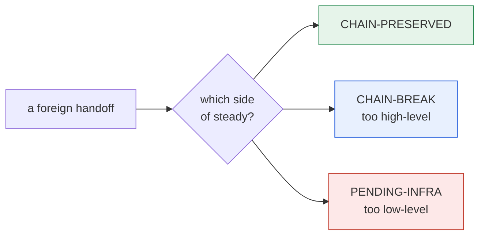

The fourth class, `NEUTRAL`, means a person should look. Each class carries a
resolution id that names the next move.

| Class | Meaning | Resolution |
| --- | --- | --- |
| `ERROR-HANDLING-CHAIN-PRESERVED` | steady: the foreign error is kept as `source` | `ERROR-RESOLUTION-MAINTAIN-EXEMPLAR` |
| `ERROR-HANDLING-CHAIN-BREAK` | too high-level: a `map_err` stringified or dropped the cause | `ERROR-RESOLUTION-REPLACE-STRINGIFY-MAP-ERR` |
| `ERROR-HANDLING-PENDING-INFRA` | too low-level: a foreign error with no crate-owned `source` to hold it yet | `ERROR-RESOLUTION-ADD-INFRA-THEN-QUESTION-MARK` |
| `ERROR-HANDLING-NEUTRAL` | unclear: a person should look | `ERROR-RESOLUTION-MANUAL-REVIEW` |

The checks run in a fixed order, and the first one that matches wins:

1. A site where the chain probe already found the cause preserved is
   `CHAIN-PRESERVED`.
2. A site where a `map_err` dropped the cause is `CHAIN-BREAK`.
3. For the remaining `?` sites, `.ok()?` on an Option is `NEUTRAL`.
   `std::fmt::Error`, `into_diagnostic` in a test or binary, and any foreign type
   that already has a `From` bridge are `CHAIN-PRESERVED`. Everything else is
   `PENDING-INFRA`.
4. Other site kinds are `NEUTRAL`.

A finding also says how to fix itself. The checklist groups rows by class and
then by foreign type, and each row pairs the offending code with a rewrite and a
resolution. An illustrative row looks like this:

```markdown
### Chain break (bad code → migrate)

#### `std::io::Error`

- [ ] `load_config` — `src/config.rs:41` — `ERROR-RESOLUTION-REPLACE-STRINGIFY-MAP-ERR`
  - bad: `std::fs::read_to_string(…).map_err(…)`
  - good: `std::fs::read_to_string(…)?`
  - resolution: Introduce a crate error newtype (or enum variant) that holds
    `std::io::Error` as `source` and implements `std::error::Error` +
    `From<std::io::Error>`. …
```

If the crate already has a constructor that keeps that foreign type, the
resolution names it instead of asking for a new newtype. The summary file rolls
the rows up into a *preservation rate*, preserved over preserved plus breaks, and
a *migration backlog*, breaks plus pending infrastructure, both broken down per
foreign type.

### Exceptions that prevent overcorrection

A rule that always demands a wrapper will eventually demand one around an error
that carries nothing, and an agent that sees enough pointless findings stops
trusting the useful ones. So some handoffs that look too low-level are exempt.

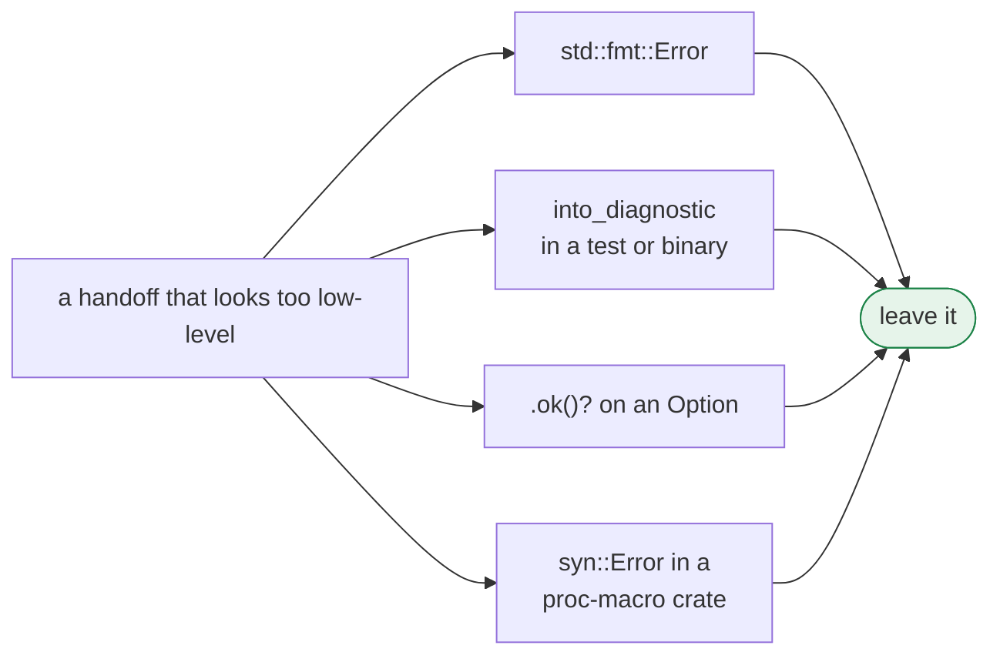

`fmt::Error` has no message and no OS code, so a wrapper has nothing to keep.
`into_diagnostic` is the correct surface for tests and binaries. `.ok()?` is
Option propagation, not a `Result` handoff. In a proc-macro crate the only
consumer is the compiler, so `syn::Error` is the idiomatic error type for
expansion helpers.

## Putting it together

Each part, labeled with the lints that play it:

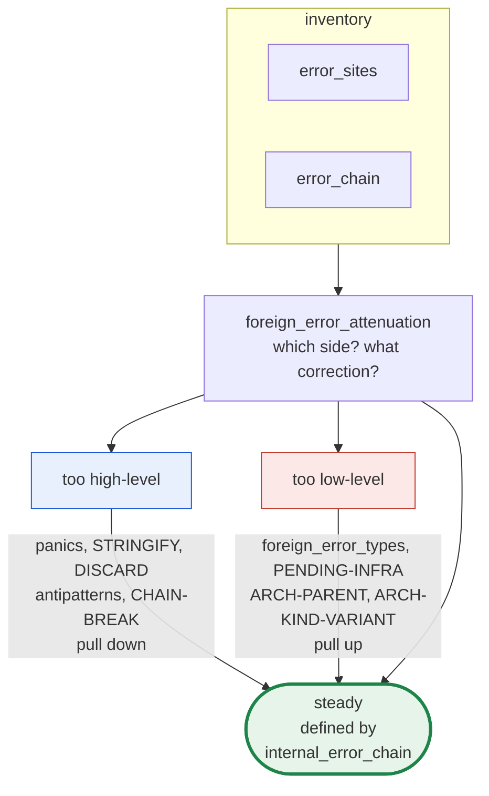

This is the machine behind the loop at the top of the article. Because the
corrections come from both sides, an agent's edits converge instead of swinging
between failure modes.

## Trying it

```sh
cordial explain                               # list every etiquette
cordial explain foreign_error_attenuation     # one etiquette's page
cordial quality -p .                          # run the suite
cordial view findings/quality-report.md       # read the report
```

Each etiquette can be switched off in `cordial.toml` (for example
`[foreign_error_attenuation] enabled = false`), and individual findings can be
excused with `cordial exceptions`, keyed by the rule ids above.
