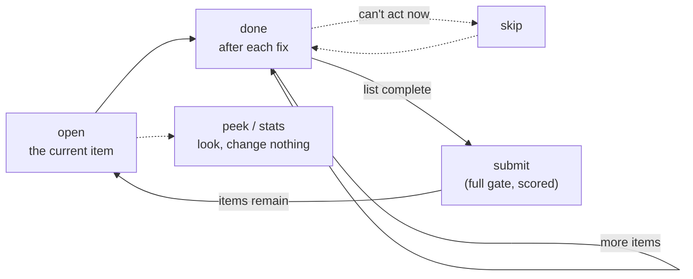

# Agent worklist: `open`, `done`, `skip`, `submit`

Status: **Active**

A CLI layer over the existing library. It gives an agent working through
cordial's report a stable list and a cursor to move down it, and runs the full
gate only when the agent asks to be scored. A built-in `instructions` command
tells the agent how to use all of it.

Terms used throughout:

- **Gate**: a full cordial run that produces the quality report.
- **Checklist**: one of the markdown files the gate writes under `findings/`.
- **List** (or worklist): the unchecked items from the checklists, plus a cursor
  and each item's state, kept in one file between gate runs.
- **Item**: one entry on the list. **Area**: a group of items under one heading
  in the quality report, such as "Error handling".

## Problem

An agent using cordial is in a loop: run the gate, read the report, pick an
item, fix it, run the gate again to see whether the list got shorter. The loop
is described from the agent's side in the "An agent in a loop" section of
[the error-handling deep dive](../error-handling-deep-dive.md).

Three things about that loop waste effort:

- **Finding the report.** The agent has to know which of the files under
  `findings/` to open. `quality-report.md` points at per-area checklists, and an
  area can span several of them.
- **Re-running the gate to see progress.** The gate is a full session: parse
  every crate, build the graph, and for some etiquettes shell out (`doc_warnings`
  runs `cargo doc`, `feature_warnings` runs the feature powerset). The agent
  pays that cost after every fix to learn whether one item cleared.
- **Chasing a moving target.** Each re-run rebuilds the list. Items vanish, but
  new ones appear, and the agent never gets a fixed list to finish. Agents tend
  to clear the first item and re-run, when they have a list of ten and most
  fixes are independent of each other.

## Idea

Give the agent a list with a cursor. `open` shows the item under the cursor,
`done` and `skip` move it, and the gate runs again only on `submit`, which scores
the batch.



The list is a snapshot taken at the last gate run. Moving through it costs a
file read and a file write. Fixes still happen in the source tree, but the list
does not change until the next gate.

## Goals and non-goals

Goals:

- A short path through the common case: `open`, then `done` or `skip` for each
  item, then `submit`.
- Commands that are safe to retry and safe to run out of order, because agents
  retry on timeouts and fix things by file, not by list position.
- A list that is fixed between gate runs, with visible progress.
- One deliberate scoring step that tells the agent which of its claims held.
- Written instructions that ship with the tool, so the agent does not have to
  work out the loop.
- Library code, public, with a thin CLI on top.

Non-goals:

- **Verifying an item without the gate.** `done` records a claim, not a result.
  Only `submit` knows whether the fix worked.
- **Automatic fixes.** `quality --apply` already exists and is unrelated.
- **Several agents on one store.** They would share one list and one cursor.
  Commands issued concurrently by a single agent are supported (see
  [Concurrent commands](#concurrent-commands)).
- **New findings or new etiquettes.** The worklist reads what the gate already
  reports.

## Commands

The loop:

| Command | What it does |
| --- | --- |
| `cordial open` | Show the current item. Builds the list first if there is none, or if it is no longer valid |
| `cordial done [ID...]` | Check off the named items, or the current item if none are named. Then show the item the cursor is on |
| `cordial skip [ID...] [--reason TEXT]` | Set the named items aside without checking them off, or the current item if none are named. Then show the item the cursor is on. The reason is remembered |
| `cordial submit [--deny-open] [--tier NAME]` | Run the full gate, score the checked-off items against it, and start a fresh list |

Beside the loop:

| Command | What it does |
| --- | --- |
| `cordial peek` | Show the current item, changing nothing and never building a list |
| `cordial stats` | Print the number of open items, with a per-area table |
| `cordial stats --verbose [--area TITLE] [--all]` | Print the checklist, with checked items marked and the current item pointed at. Capped unless `--all` |
| `cordial instructions` | Print how to use the commands above, as a step-by-step loop |

`--reason` and `--tier` ship in release 2 (see [Phases](#phases)).

`done` and `skip` are the two things an agent can do with an item: finish it or
put it down. `open` and `peek` look at it. The common case takes no arguments, so
the agent holds a cursor and moves it with a single word. The output always
prints the form with the id, so a copied command is the safe one.

A hidden `cordial next` changes nothing. It prints "Did you mean `cordial done`
or `cordial skip`?" and exits non-zero, because agents will guess that name and
the guess must not move the cursor.

All of the commands respect the global `--project`, `--store-home`, and
`--crate-name` options.

### Item ids

Every item has an id: six hex digits of a hash of its scoring key (see
[Scoring](#scoring)). If two items with different keys share those six digits,
both ids grow by one digit until they differ. Two items with the same key get
`-2`, `-3`, and so on. The header of every shown
item carries its id, and every hint uses it.

Ids are the handles; positions ("Item 4 of 12") are only for display. The reason
is retries and drift:

- A harness that retries a timed-out `cordial done` would, with bare `done`,
  check off two items. `cordial done 7c1e90` run twice checks off one.
- After `submit`, positions renumber. An id comes from the item's scoring key, so
  a stale `cordial done 7c1e90` either names the same item or fails with "No item
  7c1e90 on this list". It never checks off a different one.
- An agent that fixes several items in one file can name them in one call.

Bare `done` and `skip` stay available for the case where the agent is looking at
the current item and has just fixed it.

### Starting a list

`open` is the entry point. When there is no list, it runs the gate with the
default tiers (every enabled etiquette, until [Gate tiers](gate-tiers.md) lands),
writes the list, and shows the first item, so the agent never has to be told to
run another command first. When the list exists but is no longer
valid (see [When a list is no longer valid](#when-a-list-is-no-longer-valid)),
`open` rebuilds it and says why.

`peek`, `stats`, `done`, and `skip` never build a list. With none present they
say "No list yet." and name `cordial open` on the `NEXT:` line.

`submit` on a project with no previous list runs the gate and writes the first
list, and has nothing to score.

### Output

Every command ends with a line saying what to do next, and two prefixes are
reserved so an agent that reads only the tail can rely on them:

- `NEXT:` names the next command to run.
- `STOP:` means stop and tell the user. It is used for items that have come back
  too many times, and nowhere else. It ships with pass counts in release 2.

The sketches show the shape. Wording will change. Each is a separate snapshot,
not one session, and they include the release 2 elements (skip reasons, pass
counts, the soft-stale line, and tiers).

```text
$ cordial open
No list yet. Built list 1: 12 open.

Item 1 of 12 · 7c1e90 · priority 1 · Error handling
  `read_all` — `src/store.rs:52` — `unwrap`
Fix:   return the error with `?` and give `StoreError` a variant for it
Why:   cordial explain panics
Also in src/store.rs: 3 (b04d1a), 5 (e92f30)

NEXT: fix it, then `cordial done 7c1e90`. New here? `cordial instructions`.
```

The `Fix:` line is the guidance the checklist already prints for the item's
section (see [Where the items come from](#where-the-items-come-from)); an item
under a section with no guidance shows only `Why:`. The `Also in` line lists
other open items in the same file, so the agent can fix them together and name
them in one `done`.

```text
$ cordial done 7c1e90 b04d1a e92f30
Checked off 7c1e90: `read_all` — `src/store.rs:52` — `unwrap`
Checked off b04d1a: `write_all` — `src/store.rs:70` — `unwrap`
Checked off e92f30: `open_dir` — `src/store.rs:91` — `expect`

Item 2 of 12 · 3a77d2 · priority 1 · Error handling
  `parse_config` — `src/config.rs:41` — `Box<dyn Error>`
Why:   cordial explain foreign_error_types

NEXT: fix it, then `cordial done 3a77d2`. 8 open after this one.
```

Echoing each item that was checked off puts the claim in the agent's own
transcript, where it can be audited.

```text
$ cordial done 7c1e90
7c1e90 was already checked off. Nothing changed.

Item 2 of 12 · 3a77d2 · priority 1 · Error handling
  ...
```

```text
$ cordial skip 3a77d2 --reason "needs a decision on the public error type"
Set aside 3a77d2: `parse_config` — `src/config.rs:41` — `Box<dyn Error>`
It stays unchecked, and `cordial submit` brings it back on the next list.

Item 3 of 12 · 91be0f · priority 1 · Error handling
  ...
```

```text
$ cordial peek
Item 3 of 12 · 91be0f · priority 1 · Error handling
  `load_all` — `src/store.rs:88` — `Box<dyn Error>`
Why:   cordial explain foreign_error_types

NEXT: `cordial done 91be0f` when this one is fixed, or `cordial skip 91be0f`.
```

```text
$ cordial stats
List 3: 9 open, 3 checked off (unverified). Covers tiers: quick, build.
Built 40 minutes ago; 6 source files changed since.

 Priority  Area             Open  Checked
        1  Error handling      4        2
        2  Antipatterns        3        1
        5  Modularity          2        0

NEXT: current item is 4 of 12. `cordial peek` shows it.
```

```text
$ cordial stats --verbose
9 open, 3 checked off (unverified).

Error handling (4 open, 2 checked)
  [x] 7c1e90  `read_all` — `src/store.rs:52` — `unwrap`
  [x] b04d1a  `write_all` — `src/store.rs:70` — `unwrap`
  [>] 3a77d2  `parse_config` — `src/config.rs:41` — `Box<dyn Error>`
  [ ] 91be0f  `load_all` — `src/store.rs:88` — `Box<dyn Error>`
  ...
Showing 25 of 112 items.

NEXT: `--area <title>` shows one area, `--all` shows everything.
```

An item that keeps coming back says so, and shows why it was skipped:

```text
$ cordial done 3a77d2
Checked off 3a77d2: ...

Item 7 of 12 · 5d20ab · priority 3 · Antipatterns · on its 3rd list
  `merge` — `src/merge.rs:77` — `Box<dyn Error>`
Skipped before: "needs a decision on the public error type" (list 1)
                "still waiting on the decision" (list 2)

STOP: this item has come back on 3 lists. Tell the user what is blocking it.
```

At the end of the list:

```text
$ cordial done 6f10c4
Checked off 6f10c4: `emit` — `src/emit.rs:30` — `unwrap`

The list is complete. 2 items were skipped.

NEXT: run `cordial submit` to check your work and build a fresh list.
```

The same message follows a `skip` that leaves nothing open.

```text
$ cordial submit
Gate: 3 open items remain (5 at the last run).
Of 3 items checked off: 2 cleared, 1 still open.
Cleared claims: 7c1e90, b04d1a.
Reopened claims: 3a77d2.
Cleared without being checked off: 1.
Skipped: 1, carried to the new list.
New since the last run: 1.

 Priority  Area             Was  Now
        1  Error handling     3    1
        2  Antipatterns       2    2

Needs the user (on 3 lists): 1 item, 5d20ab. See `cordial stats --verbose`.

NEXT: new list written (list 4), reopened items first. `cordial open` shows the first.
```

`submit` exits 0 when it completed the gate and scored the list, whether or not
items remain, because that is the normal path and a harness may treat any other
status as a failure to retry. It exits non-zero only when it failed to run.
`submit --deny-open` adds the CI behavior and exits non-zero while open items
remain, the same as `cordial quality --deny-open`.
The cleared and reopened claim lines name the checked-off ids, so an agent can
see which claims held without a separate `stats` call. Empty lines are omitted.
When identical scoring keys prevent attribution, `submit` names the affected ids
as an ambiguous group with its cleared and still-present counts instead of
claiming that a particular id cleared.

### Cursor rules

The list has a cursor. Items are ordered by area priority, which is the report's
resolution order, then by the order of the area's checklists, then by position in
the checklist. Reopened items (see [Scoring](#scoring)) sort first within their
area.

- A fresh list has no current item. `open` and `peek` both show item 1 and make
  it current, and neither checks anything off.
- With no id, `done` and `skip` act on the current item. With none current they
  fail with "No current item" and a `NEXT:` line naming `cordial open`. That is
  what stops a bare `done` from checking off an item the agent has never been
  shown.
- With ids, they act on those items, whether or not they are current. An id that
  is not on the list fails the whole command before anything changes.
- Both are idempotent. `done` on an item that is already done changes nothing and
  says so. `skip` on an item that is already skipped does the same. `done` on a
  skipped item checks it off, and `skip` on a done item fails, since it would
  undo a claim.
- The cursor moves only when the current item was among those acted on. It moves
  to the next open item. If it did not move, the output shows the unchanged
  current item. If there was no current item, the cursor is placed on the first
  open item.
- `skip` marks the item skipped and leaves it unchecked, so it still counts as
  open in `stats` and in the scorecard.
- Skipped items are not handed out again on the same list. The list is complete
  when no open items remain, whether the last one was done or skipped. The
  `done` or `skip` that closes it says "The list is complete" and names
  `submit`, and so does any later `open` or `peek`, because the cursor is past
  the end. Skipped items come back on the next list.
- When every item is done, the completion message omits the skipped line.
- `open` and `peek` never change the state of an item.

## When a list is no longer valid

A list is a snapshot, and the agent edits the source tree while it holds one, so
"the source changed" cannot mean "rebuild". A rebuild also discards the agent's
checked-off items. Validity is therefore split into two kinds of signal.

**Hard-invalid.** The list no longer means what it said, regardless of the source
tree. The list records three things when it is built, and any mismatch makes it
invalid:

- the list's schema version,
- the cordial version, and
- a fingerprint of the effective configuration. `CordialConfig` already
  serializes, so the fingerprint is a hash of that value. A change to
  `cordial.toml` changes what findings exist, so the old items cannot be trusted.

`open` rebuilds a hard-invalid list and says why, and how many checked-off items
that discarded. `peek` and `stats` report that the list is out of date and name
`cordial open`. They do not rebuild.

**Soft-stale** (release 2). The source tree has moved on. The list records when it was built,
and `stats` prints the list's age and the number of Rust sources and manifests
modified since, with the same newest-mtime comparison that
`amenable_dump_registry.rs` already uses for its dump. `open` prints that line
only when the list is older than a limit, set as a constant (one day to start).
Neither command rebuilds. The agent or the user decides.

Rebuilding stays an explicit act: `submit`, `quality`, or `run`, or `open` when
there is nothing valid to open.

## Concurrent commands

Agents are fast, and many harnesses issue tool calls in parallel. An agent that
fires `submit` and `open` together expects `open` to show the new list. Two
parallel `done` calls must not lose an update. Both are races on one file, and
the design settles them with a lock and a label, not with advice.

**One lock.** The store has a lock file, `{store}/worklist.lock`, held with an
advisory file lock. It is a separate file because the list file is replaced by a
rename, which would drop a lock held on it. The operating system releases the lock
when the holder exits, so a killed command leaves nothing behind.

| Command | Lock |
| --- | --- |
| `submit`, `quality`, `run`, `coverage`, and `open` when it builds | Exclusive, held for the whole gate run |
| `done`, `skip` | Exclusive, held for the read, change, and write |
| `peek`, `stats`, `open` on a valid list | Shared, held while reading |

**Waiting, not failing.** A command that cannot take its lock waits for the
holder to finish. In the case above, `open` blocks until `submit` has written the
new list and then shows it. It does not read the old list, and it does not fail
and force a retry. While it waits, it writes a progress line to stderr every few
seconds, naming the holder (`waiting for submit, started 1m12s ago`), so the
agent can tell it is not hung. The lock file records the holder's command and
start time for that message. A wait that passes a limit, set as a constant (thirty
minutes to start), fails with an error that names the holder.

**Check again after waiting.** `open` that finds no list takes the exclusive lock
and checks again before building. If another command built the list while it
waited, it uses that list. Two parallel `open` calls therefore build once.

**A crash does not corrupt the list.** The gate writes the new list only at the
end, by renaming a temporary file into place. A `submit` killed halfway, for
example by a harness timeout, leaves the old list as it was, and its lock is
released.

**Labeled lists.** Every list has a generation number, which `submit` and any
other gate run increase by one. `open`, `peek`, `stats`, and `submit` print it
("list 3"). It covers the one case the lock cannot: if `open` takes the lock
before `submit` has started, it shows the old list, correctly, and the label shows
which list that was. An agent that sees `submit` report "new list written (list
4)" next to an `open` that said "list 3" can tell what happened.

**What the lock does not fix.** Bare `done` and `skip` act on whatever is current
when they run, so two of them in parallel check off two different items. Ids make
the commands independent of order, and the instructions tell the agent to name
ids when it issues several calls at once, and to run `submit` on its own and wait
for it.

## Progress on long commands

An agent running a command that takes minutes needs a sign that it is working.
Commands that can run for more than a moment report progress through the
existing `ProgressSink`, which the CLI backs with indicatif
(`src/cli/progress.rs`): a spinner for stages and a bar for counted work.

| Reports progress | Draws nothing |
| --- | --- |
| `open` when it builds, `submit`, `quality`, `run`, `coverage`, `timings` | `done`, `skip`, `peek`, `stats`, `instructions` |

`quality`, `run`, and `coverage` already do. `open` and `submit` get it by going
through the same run path. `timings` (see [Gate tiers](gate-tiers.md)) shows one
spinner per etiquette per pass.

There is a gap for exactly this audience. `IndicatifProgress::new` hides the draw
target when stderr is not a terminal, and an agent's shell is not one, so the
spinner would never be seen. The fix is a line-oriented mode for non-terminal
stderr:

- one line when a stage starts and one when it finishes,
- a heartbeat line every few seconds while a stage runs, such as
  `still working: Running doc_warnings (42s)`, with the interval a constant
  (ten seconds to start),
- all of it on stderr, so stdout carries only the result and stays clean to pipe.

This is a second `ProgressSink` implementation that the CLI picks at
construction, the same place it picks the draw target now. The trait does not
change, and library callers keep the no-op sink. `CORDIAL_NO_PROGRESS` still
silences everything. Whether the lines come from a custom indicatif `TermLike` or
a small heartbeat thread is an implementation choice; the requirement is lines
and not redraws.

A harness that buffers output until the command exits will show nothing either
way, and the instructions say so: the first `open` can take a few minutes on a
large project, so run it with a long timeout or in the background.

## Instructions

The agent should not have to infer the loop from the command names. The tool
carries its own instructions in three places, all compiled from one source.

- **`cordial instructions`** prints the full loop. `AGENTS.md` tells agents to
  run it first, and it is the text to paste into other agent configuration.
- **`--help`** on each command carries the one or two lines about that command,
  taken from the same source.
- **The `NEXT:` line of each command's output** names the next step, as in the
  sketches above. `open` adds "New here? `cordial instructions`" when it has just
  built the list.

The text of `cordial instructions`, as a starting point:

```text
How to work through cordial's open items

1. Run `cordial open`. It shows the top item, and builds the list if there isn't
   one yet. Building can take a few minutes on a large project, so run it with a
   long timeout.
2. Fix the item, then run `cordial done <id>`, using the id on the item's header
   line. That checks it off and shows the next item.
3. If you can't act on an item right now, run
   `cordial skip <id> --reason "<why>"`. It stays unchecked and the cursor moves
   on. The reason is kept, and shown if the item comes back.
4. When cordial says the list is complete, run `cordial submit`. It reruns the
   gate, tells you which of your fixes held, and builds a fresh list.

The work is finished when `submit` reports no open items, or only items marked
`STOP:`. Don't report it complete before then. `submit` is the only step that
checks anything.

You can work out of order. The id names the item, so fix several items together
(the item lists others in the same file) and run `cordial done <id> <id> <id>`.
Running `done` twice on the same id is harmless. Without an id, `done` and `skip`
act on the current item, so when you send several commands at once, always name
the ids.

Run `cordial submit` on its own and wait for it. If you run another cordial
command while it is running, that command waits for it and then shows the new
list.

Two commands look without changing anything: `cordial peek` shows the current
item again, and `cordial stats` shows how many items are open, by area. Add
`--verbose` to `stats` for the list, and `--area <title>` to narrow it.

`done` is a claim that you made the fix, so run it only after you have, and after
you have run the project's own checks for the code you touched. Cordial does not
know what those are (a build, a test run, a feature check), so that part is on
you. `submit` is what checks the claim, for the findings it covers.

Some findings are intended. If one is, don't change the code and don't skip it:
run the `cordial explain` command the item names to see how to document an
exception, and once you have, run `done`. The next gate drops it from the list.

Use `done` and `skip` as you go. They are cheap and fast. `submit` is neither, so
run it once per batch and not once per fix, but do run it at the end. Don't go
back to skipped items; `submit` brings them back on the next list.

Item locations are hints. Line numbers shift as you edit, so search for the
symbol named in the item before giving up on it. If your own change removed the
code an item was about, run `done` and let `submit` confirm. If the item no longer
makes sense for some other reason, run `skip` and say why.

A line that starts with `NEXT:` says what to run next. A line that starts with
`STOP:` means stop and tell the user. Do not try that item again.
```

That is the release 2 text. Release 1 omits `--reason`, the reasons, and the
`STOP:` paragraph.

The text lives in one constant in the library, and a test under `tests/` checks
that every `cordial <word>` it mentions is a real subcommand, so the instructions
cannot drift from the commands. This is the same principle as
`cordial explain`: the compiled text is the authority, and `AGENTS.md` points at
it instead of repeating it. The split of authority is short: `cordial
instructions` covers the workflow, and `cordial explain` covers what a rule means
and how to opt out of it.

## Where the items come from

An item is one unchecked line (`- [ ]`) in an area's checklist, together with any
indented lines beneath it. The checklists are the artifacts the report already
tells an agent to work, so the worklist follows them and adds nothing a human
could not read.

Checklists are written by each etiquette's reporter, and the formats differ. Most
use `` `context` — `file:line` — `snippet` ``. Some put a rule id inline (for
example `visibility`, `cli_layout`, `cfg_hygiene`, and `crate_attrs`), and some
follow the line with indented detail (for example `cfg_scatter`, `derives`,
`cli_layout`, and the method bullets under a `modularity` hotspot). The parser
does not interpret the fields. It reads structure, and picks out a backticked
`path:line` where there is one, to learn which file the item is in.

Each item keeps:

- the area it belongs to (priority and title from the quality report),
- the heading trail above it in the checklist (crate, surface, kind, or rule id,
  depending on the etiquette),
- the item line and its indented detail lines, verbatim,
- the guidance for its section, when there is any, and
- the file the item points at, when the line names one as `` `path:line` ``, for
  the `Also in` line.

**Guidance.** Many checklists print a short italic paragraph under a heading that
says what to do about everything beneath it, such as the surface-specific abort
action under each `panics` section. An item takes the italic paragraph under the
closest heading above it, or failing that under the nearest enclosing heading
that has one, and the item display shows it as `Fix:`. For `panics` that means
the items under a kind heading inherit the paragraph from the surface heading
above. The guidance is already written for each lint, so nothing new is needed
from the etiquettes. An item with no guidance in scope shows only the
`cordial explain` pointer, built from the owning area's etiquette id.

**Documented exceptions.** In the quality checklists, `- [x]` lines sit under
"Documented exceptions" and mean "resolved on purpose". They are not items. The
coverage etiquettes also use `- [x]`, to mean "covered", but they do not
contribute to the quality rollup and the worklist does not read them.

### Areas can span several checklists

`QualityAreaSummary` names one primary checklist, but some areas count items in
several artifacts. Error handling counts open panic sites, foreign error
attenuation sites, distinct internal error chain violations, and two error
antipattern rules. The `error-sites` and `error-chain-preserved` artifacts add
context for some of those sites; `foreign-error-types` belongs to its own area.
The worklist needs the exact actionable sources, so the area gains an explicit
set of checklist files and, where needed, rule sections:

- `QualityAreaSummary::checklists()` returns each actionable checklist source
  for the area, with optional rule-section filters. It defaults to the single
  `checklist()` name.
- `QualityAreaSpec` gets an additive builder, `with_extra_checklists`, for areas
  that span more than one. `QualityAreaSpec::new` is unchanged, so existing
  plugins compile as they are.
- Error handling lists `panics`, `internal-error-chain`,
  `foreign-error-attenuation`, and the Box/String error sections of
  `antipatterns`. The Antipatterns area selects its own sections from that
  shared file. When an internal violation is already an attenuation item at the
  same site, its internal checklist entry is a cross-reference, not a second
  unchecked item.

### Counts and checklists must agree

The gate's number is `QualityReport::total_open_items`, which comes from each
area's compute function over findings. The worklist's number is the count of
unchecked checklist lines. If those differ, an agent is told one thing by `stats`
and another by the gate.

The rule: for every area, open items from the report equal unchecked lines in its
selected checklist sections. A test over fixture projects enforces it. Where they
differ, the area's checklist selection, checklist rendering, or count is the bug;
the fix belongs there and not in the worklist.

### A seam for later

Parsing markdown is the cheapest source that covers every etiquette without
touching their reporters, and it already carries the guidance. It does not carry
a rule id for every item, and it cannot fill in a ready-made exception command.
So the worklist reads items through a trait:

```rust
pub trait ItemSource {
    /// Items for one area, in checklist order.
    fn items(&self, area: &QualityAreaSummary) -> CordialResult<Vec<WorklistItem>>;
}
```

The first implementation reads checklists. A later one can read structured
findings and add the rule id for every item, and with it a prefilled
`cordial exceptions add` line for items that are intended. That is an
improvement and not a dependency: the commands, the guidance, and the
instructions all work from the checklists.

## State

One file, `{store}/worklist.json`, reached through a new
`StoreLayout::worklist_path()`. It sits beside `findings/`, not inside it, because
`findings/` holds reports and this is working state. The gate writes it and `done`
and `skip` update it. It holds:

- how it was built: schema version, cordial version, configuration fingerprint,
  generation number, timestamp, project slug, and the tiers it covered (see
  [Gate tiers](gate-tiers.md)), so `submit` repeats the same run,
- the items, each with an id, position, area, heading trail, the item line and its
  detail lines, its guidance, a state of `open`, `done`, or `skipped`, and a
  `reopened` flag,
- from release 2, each item's pass count (see [Passes](#passes)) and the skip
  reasons recorded so far,
- the cursor.

The file is a generated artifact under the store. It is never committed. Writes
go to a temporary file and are renamed into place. Skip reasons are free text
from the agent and stay in the store.

### Staleness is expected

The agent edits source files between gate runs, so the list is out of date by
design. Line numbers in item text drift. That does not matter to the list,
because items are not re-derived until the next gate, and a claim only needs an
id to be checked off. It does matter to the agent, which is why the instructions
say to search for the symbol, not to trust the line. `open` and `stats` say
"unverified" next to checked counts.

## Tiers (release 2)

[Gate tiers](gate-tiers.md) lets a run select the cheap etiquettes and skip the
expensive ones. The worklist builds on that once it lands:

- `submit` repeats the tiers the previous run used. `submit --tier <name>`
  overrides them, so an agent can check an area cheaply with `--tier quick` and
  finish with `submit --tier all`.
- Items from a tier that a `submit` did not run carry over from the previous
  list unchanged and are marked unverified. They are never scored as cleared.
- `stats` says which tiers the current list covers.

This answers the cost of verification without changing the commands: the gate can
be cheap enough to re-run per area when the tier is chosen well.

## Scoring

`submit` runs the gate, builds the new list, and compares it to the previous one.
Items are matched across the two lists by a key that leaves out line numbers:

```text
(area, heading trail, item line with its line number removed)
```

The key uses the item line only, not its detail lines, and removes a line number
written as `:{line}` or `(line {n})`. Keys are matched as a multiset, so repeated
identical items count correctly. The key is also what the item id hashes, so a
matched item keeps its id from one list to the next.

For items whose outcome can be attributed to an id, each old item gets one of
these outcomes, and each item only in the new list is **New**:

| Outcome | Meaning |
| --- | --- |
| **Cleared** | Absent from the new list, whether or not it was checked off |
| **Reopened** | Checked off in the old list, still present in the new one |
| **Skipped** | Skipped in the old list, still present in the new one |
| **Remaining** | Never touched, still present |

If an identical-key group partly survives, the scorecard records its old ids and
the group's cleared and still-present counts. It does not assign a particular
old id to either side. The summary reports cleared items checked off and cleared
without being checked off when those counts are determinable; otherwise it
reports definite outcomes and the ambiguous group separately. This also avoids
claiming an exact checked-off split when the group mixes checked and untouched
items. The cleared-without-check-off count shows side effects of other fixes.

Reopened items are marked as such in the new list and sort ahead of others in
their area, so a claim that did not hold gets looked at first. An item whose key
changes between lists scores as one cleared item and one new one. That happens
when a function is renamed, and when the item line carries a number that moves,
such as the line count in a `modularity` item. It is accepted, and both numbers
are shown.

### Passes (release 2)

An agent will lose context between lists, so it cannot be relied on to remember
that an item has already defeated it, or why. The tool remembers instead.

- Every item has a pass count. It is 1 the first time the item appears.
- When `submit` matches an item that the agent skipped or checked off on the old
  list, the item in the new list carries the old count plus one, and any skip
  reasons.
- An item the agent never touched keeps its count.
- When an item's pass count reaches the limit, every command that shows it labels
  it ("on its 3rd list"), lists the skip reasons, and ends with a `STOP:` line
  telling the agent to tell the user. `submit` lists such items in its summary.
  The item is still shown, because the user may answer with a one-line hint and
  the agent should be able to continue.
- The limit is 3 and is set by `max_passes` under `[worklist]` in `cordial.toml`.

Because the key leaves out line numbers, a count survives edits that move code,
and it resets when the key changes, for example after a rename.

## Library design

New module `src/worklist.rs`, a barrel of `mod` and `pub use`, with named
siblings under `src/worklist/`. Gated on the existing `quality` feature at the
module level, with no new feature flag.

| File | Holds |
| --- | --- |
| `item.rs` | `WorklistItem`, `ItemId`, `ItemState` |
| `source.rs` | `ItemSource`, `ChecklistSource` (parses checklist markdown) |
| `state.rs` | `Worklist`: read, atomic write, cursor moves, counts |
| `lock.rs` | the store lock, its holder record, and the wait with progress |
| `validity.rs` | the build record, `Validity`, and the soft-stale report |
| `score.rs` | `Scorecard` with per-claim outcomes and ambiguous groups, `score(previous, current)`, pass-count carry-over |
| `render.rs` | text rendering for each command, including the `NEXT:` and `STOP:` lines |
| `instructions.rs` | the instructions text and the per-command help lines |

The public surface is small: `Worklist::build`, `Worklist::read`,
`Worklist::write`, `Worklist::validity`, `Worklist::open_count`,
`Worklist::current`, `Worklist::peek`, `Worklist::done`, `Worklist::skip`,
`score`, and the instructions constants. Release 2 adds `Worklist::staleness`.
`build` takes the quality report, the store, and an `ItemSource`. `done` and
`skip` take a slice of ids, which is empty for "the current item", and `skip`
takes an optional reason. The CLI is the first caller, and nothing in the library
prints.
Command logic returns typed results, including the `Scorecard` from `submit`;
`render.rs` turns those results into text. Renderers never recover claim ids or
outcomes by parsing another command's output. The optional JSON output in phase
13 can consume the same results.

The gate-side hook is in `execute_run_plugins` in `src/cli/run.rs`, which builds
the quality report in order to count open items. It returns the report as well as
the count, and a new step writes the list after the artifacts exist, because the
list reads the checklist files the reporters just wrote. Every gate run writes a
fresh list, so `cordial quality` and `cordial run` start one too. Phase 3
confirms that the reporters have finished writing by that point, since the order
matters.

## CLI wiring

Following the layout rules in
[One crate, CLI in the library](one-crate-cli-layout.md):

- `Commands` gains `Open`, `Done { ids }`, `Skip { ids, reason }`, `Peek`,
  `Stats { verbose, area, all }`, `Submit { deny_open, tier }`, `Instructions`,
  and a hidden `Next`. Each arm calls a function in `src/cli/` that takes plain
  values, not clap types, so `CLI-ACT-001` stays satisfied.
- `open` calls the same run path as `submit` when the list is missing or
  hard-invalid.
- `submit` reuses the run path behind `quality`. It returns success once scoring
  completes, and returns the existing `CordialError::open_findings` only under
  `--deny-open`.
- The non-terminal progress mode lives next to `IndicatifProgress` in
  `src/cli/progress.rs`, chosen where the draw target is chosen now.
- New failures become native sources on `CordialErrorKind`, in the same tree as
  `NotFound` and the others: no list yet, a list that is out of date, a corrupt
  list file, no current item, and an unknown item id. Each records its origin with
  `#[track_caller]`.

## Phases

The work ships in two releases. The first is the loop an agent can use end to
end. The second adds memory across lists and the refinements that depend on it.
Nothing in the second blocks the first.

### Release 1: the loop

1. **Progress without a terminal.** The line-oriented mode for non-terminal
   stderr, with heartbeat lines. It stands alone and helps `quality`, `run`, and
   `coverage` today, so it goes first.
2. **Areas know their checklists.** `QualityAreaSummary::checklists()`,
   `with_extra_checklists`, and the Error handling set. Add the
   counts-equal-checklists test and fix whatever it finds.
3. **The model.** `ItemSource`, `ChecklistSource` (items, indented detail, section
   guidance, heading trail), `Worklist`, item ids, the build record with the
   hard-invalid checks and generation number, the store lock, and the gate-side
   write. Tests over fixture checklists,
   including one from each reporter style named in
   [Where the items come from](#where-the-items-come-from), and a check that the
   reporters have finished writing when the gate-side step runs.
4. **`stats` and `open`.** The count table, `--verbose` with its cap and `--area`,
   and building the list when it is missing or hard-invalid.
5. **The cursor.** `done`, `skip`, and `peek`, with ids, idempotency, the
   fresh-list and list-complete rules, the echo of what `done` checked off, the
   `Also in` line, and the hidden `next`.
6. **`submit`.** The scorecard, per-claim cleared and reopened ids, ambiguous
   identical-key groups, the reopened-first ordering, the exit status, and
   `--deny-open`.
7. **`instructions`.** The text, `--help` lines, `NEXT:` lines, and the test that
   ties them to the real subcommands.
8. **Agent docs.** The `AGENTS.md` rewrite described below, plus
   `docs/running-cordial.md`, the README reader paths, and a link from the
   agent-loop section of the deep dive.

### Release 2: memory across lists

9. **Passes.** Pass counts, `skip --reason` and its carry-over, the `STOP:` line at
   the limit, `max_passes` (documented in `docs/planning/cordial-config.md`), and
   the "needs the user" line in `submit`. The instruction text gains the reasons
   and the `STOP:` paragraph.
10. **The soft-stale line.** Age and changed-file count in `stats` and `open`.
11. **Tiers.** `submit --tier`, carried-over items from tiers that did not run, and
    the covered-tiers line in `stats`, once [Gate tiers](gate-tiers.md) lands.
12. **Rule ids.** A structured `ItemSource` that supplies the rule id for every
    item, and with it a prefilled `cordial exceptions add` line.
13. **Optional.** `--json` output on the commands.

### Changes to `AGENTS.md`

The workflow changes enough that `AGENTS.md` needs rewriting, and it should not
change until the commands exist, so the edit lands with phase 8.

- **Authority.** Add `cordial instructions` for the workflow, beside
  `cordial explain` for what a rule means. The existing order (explain, then the
  reports) stays.
- **Quick use.** Replace the run-the-gate-then-open-the-report steps with:
  `cordial instructions` once, then `cordial open`, `done` or `skip`, and
  `submit`, with the completion rule that the work is finished when `submit`
  reports nothing open.
- **Reports.** Tell agents to work from `open` and `stats` and not to read the
  checklists under `findings/` directly, since the checklists do not show
  progress made on the list.
- **Promotion.** `just cordial-gate` and `cordial quality --deny-open` stay as the
  promotion check, and the text says so, so agents do not use `submit` for it.
- **Routing table.** Unchanged. It points at `cordial explain` for rules.

`CLAUDE.md` needs only a line in its workflow section pointing at
`cordial instructions`.

## Verification

Tests for release 2 items land with their phases.

- Unit tests under `tests/` for parsing: heading trails, indented detail lines
  attached to their item, section guidance inherited from an enclosing heading,
  and `[x]` lines ignored.
- Cursor tests: `open` on a fresh list, bare `done` and `skip` with no current
  item, a command that names ids placing the cursor when none was set, and
  skipped items not being handed out again.
- Scoring tests: each outcome, per-claim cleared and reopened ids in `submit`,
  the cleared-without-check-off count, and partial survival of identical keys
  with mixed checked and untouched items reported without false attribution.
- Pass count tests (release 2): carried across `submit`, unchanged for untouched
  items, and the label and `STOP:` line at the limit.
- Id tests: ids are stable across a rebuild for a matched item, `done <id>` twice
  changes one item, an unknown id fails before anything changes, and a stale id
  after `submit` never names a different item.
- Validity tests: a missing list is built by `open` and not by `peek` or `stats`;
  a changed `cordial.toml` or cordial version makes a list hard-invalid; edited
  sources make it soft-stale and never rebuild it; the hidden `next` leaves the
  list byte-for-byte unchanged.
- Concurrency tests: parallel `done` calls on different ids lose no update; `open`
  started while `submit` holds the lock waits and shows the new list, labeled with
  the new generation; two parallel `open` calls on a missing list build it once; a
  `submit` killed before it writes leaves the old list intact and its lock free;
  a wait past the limit fails and names the holder.
- Exit status tests: `submit` returns success with items remaining, and fails
  under `--deny-open`.
- Progress tests: with stderr not a terminal, a long stage produces start,
  heartbeat, and finish lines on stderr and nothing extra on stdout, and
  `CORDIAL_NO_PROGRESS` silences them.
- A test that every `cordial <word>` in the instructions text is a real
  subcommand.
- A fixture-project test that runs the gate and asserts the report's per-area
  open counts equal the list's.
- CLI tests in `tests/cli.rs` that run the binary through `open`, `done`, `skip`,
  and `submit` against a small project and check the scorecard.
- No `#[cfg(test)]` modules in `src/`.
- `just check-all`, `just check-features`, and `just cordial-gate` before
  promoting `dev`. The new code is subject to cordial's own etiquettes.

## Risks

- **Checklist formats vary.** Areas group by crate, by surface, by kind, by rule,
  or by file, and some items carry indented detail. The parser reads structure
  only: `- [ ]` lines, the indented lines under them, headings, and italic
  guidance. A checklist that uses a different marker, or puts an item in a table,
  would be missed. The counts-equal-checklists test is how that shows up, and a
  new etiquette's checklist joins the test when it joins the rollup.
- **Claims are cheap.** An agent can call `done` on everything. The scorecard and
  the pass count exist to make that visible, but nothing stops it.
- **Instructions can be ignored.** They are advice. The tool's behavior has to
  be safe when they are not followed, which is why `done` refuses to act without
  a current item, ids make retries harmless, and skipped items are not served
  twice.
- **Ids can collide.** Six hex digits make a collision among a few hundred items
  unlikely. Identical keys get a numeric suffix. A collision between different
  keys lengthens the ids of every item involved, one digit at a time, until they
  are unique, so none of them keeps the six-digit form. A stale six-digit id in
  that rare case fails with "No item" and does not name another.
- **A hard-invalid rebuild discards progress.** A config edit mid-batch costs the
  agent its checked-off items. `open` says so when it happens, and the cost is
  accepted because items under a different configuration cannot be scored fairly.
- **The soft-stale count is approximate.** Modification times can move without a
  content change. The line is informational, and nothing acts on it.
- **Waiting commands can hit the harness timeout.** A command blocked behind a
  long `submit` may be killed by the harness before the lock frees. The command is
  read-only or idempotent, so nothing is lost, and the agent can run it again.
- **File locks are advisory and weaker on network filesystems.** A store on one
  can fail to exclude another host. The store is local by default, and the doc
  makes no promise beyond that.
- **Buffering harnesses hide progress.** The heartbeat helps only where output is
  streamed or logged. The instructions tell the agent how to run the slow first
  `open` in that case.
- **Scoring keys can collide.** Two distinct items that differ only by line
  number match as a multiset, which is correct for counting. If only some
  survive, the scorecard reports group counts and affected ids without claiming
  which specific item cleared.
- **Reports and lists can drift apart over time.** The agreement test is the
  guard. It needs to stay in the gate.

## Status

Release 1:

- [x] Phase 1: progress without a terminal
- [x] Phase 2: areas know their checklists; counts equal checklists
- [x] Phase 3: model, ids, parser, build record, gate-side write
- [x] Phase 4: `stats`, `open`
- [ ] Phase 5: `done`, `skip`, `peek`, hidden `next`
- [ ] Phase 6: `submit`, scoring
- [ ] Phase 7: `instructions`
- [ ] Phase 8: agent docs, including the `AGENTS.md` rewrite

Release 2:

- [ ] Phase 9: pass counts, skip reasons, `STOP:`
- [ ] Phase 10: soft-stale line
- [ ] Phase 11: tiers
- [ ] Phase 12: rule ids and prefilled exceptions
- [ ] Phase 13: `--json`
