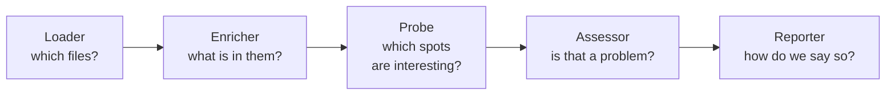

# Your First Etiquette: A `todo!()` Lint From Scratch

*Part 1 of 7. Next: [Finding the sites](writing-etiquettes-2-finding-sites.md).*

A `todo!()` is a promise to come back. Most of the time you do. Now and then
one slips through review, ships, and turns up two days later as a panic that
says "not yet implemented" in a place nobody remembers writing.

Catching that is a small job, which makes it a good first lint to write. This
series writes one for [cordial](../README.md), a plugin framework that checks
whether a Rust codebase follows the standards you care about and writes reports
for people and agents to work through. Each standard is called an *etiquette*,
and you can add your own without forking the tool. Clippy already has a lint for
`todo!()` (`clippy::todo`), so the problem is easy to state, and the only new
thing to learn is cordial's plugin machinery.

This series is for you if you can read Rust and have the cordial repository
checked out. You don't need to know `syn` or `petgraph`. The posts introduce
what they use.

## What done looks like

Pointed at a crate, the lint should report every `todo!()` as a *finding*, which
is cordial's word for one reported problem. Each finding carries a rule id
(`ACME-TODO-001`), the file and line, and the name of the function the macro
sits in. For a crate whose `src/lib.rs` has a `todo!()` on line 2 of a function
named `leftover`, that is one finding: `src/lib.rs`, line 2, function
`leftover`.

That is enough to design from. We need to find the macro calls, say where they
are, judge each one, and hand the result to whoever is reading.

## How the series works

Each post covers one stretch of the way from an empty file to that finding, and
ends with a short checkpoint of what exists so far.

1. **The plan and the rule** (this post): the five jobs a check is split into,
   and the rule's name.
2. [**Finding the sites**](writing-etiquettes-2-finding-sites.md): walk the
   syntax tree and put every `todo!()` into the crate's graph.
3. [**Noticing and judging**](writing-etiquettes-3-noticing-and-judging.md):
   turn graph nodes into markers, and markers into findings.
4. [**Writing it down and bundling it up**](writing-etiquettes-4-writing-and-bundling.md):
   the reporter, the etiquette, and the plugin.
5. [**Taking it for a run**](writing-etiquettes-5-running.md): a test, then the
   real output.
6. [**When order matters**](writing-etiquettes-6-order.md): telling cordial
   which lints come first. Optional.
7. [**Make it yours**](writing-etiquettes-7-make-it-yours.md): variations, and a
   row in the quality report.

A [reference page](writing-etiquettes-reference.md) covers the pieces the series
doesn't need.

Longer code blocks carry short numbered comments (`// 1.`, `// 2.`, and so on),
and the notes after each block explain the same numbers. Read the two side by
side. The finished lint follows `examples/custom_plugins/quality.rs` in the
cordial repository, which compiles with the crate and is exercised by
`tests/custom_plugins.rs`, so keep that file open if you want the whole thing in
one piece.

One more thing to expect: a plugin you write runs through a `Session`, the
object that drives a cordial run, rather than through the `cordial` command,
which runs the built-in etiquettes. A test is the natural place to build one, so
that is where the first run happens in Part 5.

## Five questions, five hooks

Cordial splits a check into five jobs, and each job has a *hook*: a piece of
code you hand to cordial that answers one question.



The enricher is where cordial's design shows. Cordial builds a graph of each
crate's code, nodes and edges, and every check reads from it. Source enrichers
request outer Rust files through a shared parsed-file view, which parses each
path once per run and reuses that tree across hooks. Parsers for macro bodies
and other embedded languages are separate. Enrichers add facts to the graph
and probes read facts back out.

Cordial ships a loader for Rust source, so this lint writes the other four:

| Hook | Our answer | Part |
| --- | --- | --- |
| `Loader` | the crate's Rust source (cordial ships this one) | none |
| `SourceEnricher` | walk each shared parsed file, and record every `todo!()` in the graph | 2 |
| `Probe` | ask the graph for those records | 3 |
| `Assessor` | every one is a violation | 3 |
| `Reporter` | write them to a CSV | 4 |

Three words come up all through the series. A *marker* says "this site exists."
A *finding* says "this site breaks rule X." A *reporter* only formats findings
that have already been judged. Keeping the first two apart is what lets a probe
find spots without knowing what counts as a violation.

For a check clippy can do in one line, five hooks is a lot of structure, and the
honest case for it is what comes with it. Once a rule has an id and a place in
the pipeline, cordial gives it an explain page, a way to silence it on purpose,
a row in the quality report, and a position relative to other rules. The series
shows each of those in turn.

We will build the hooks in order. First, the rule they all report against.

## Naming the rule

Every finding points at a rule, and a rule is three strings.

```rust
// A rule carries no data, so it is a unit struct.
#[derive(Debug, Clone, Copy)]
struct TodoRule;

impl Rule for TodoRule {
    // The id is permanent.
    fn id(&self) -> &str {
        "ACME-TODO-001"
    }

    // The category groups related rules.
    fn category(&self) -> &str {
        "acme_style"
    }

    // One line, shown beside every finding for this rule.
    fn description(&self) -> &str {
        "Leftover `todo!()` macro — finish or delete before merge"
    }
}
```

The id deserves some thought. It shows up in reports, in `cordial explain`, and
in the exceptions that silence a finding, so treat it as permanent as soon as
anyone has used it. Cordial gives each kind of problem its own id, so a project
can silence or track one without touching the others. The category is what a
report can later count, as in [Part 7](writing-etiquettes-7-make-it-yours.md).

## What we have so far

A rule with an id, a category, and a description. It does nothing yet, but every
finding the lint ever produces will point at it, and the id will appear in
everything downstream.

Next comes the interesting part: teaching the lint to find a `todo!()` in a
file, and putting what it finds somewhere the rest of cordial can see.

**Next: [Part 2, Finding the sites](writing-etiquettes-2-finding-sites.md).**

---

**The series: Your First Etiquette.**
**1. The plan and the rule** ·
[2. Finding the sites](writing-etiquettes-2-finding-sites.md) ·
[3. Noticing and judging](writing-etiquettes-3-noticing-and-judging.md) ·
[4. Writing it down and bundling it up](writing-etiquettes-4-writing-and-bundling.md) ·
[5. Taking it for a run](writing-etiquettes-5-running.md) ·
[6. When order matters](writing-etiquettes-6-order.md) ·
[7. Make it yours](writing-etiquettes-7-make-it-yours.md) ·
[Reference](writing-etiquettes-reference.md)
